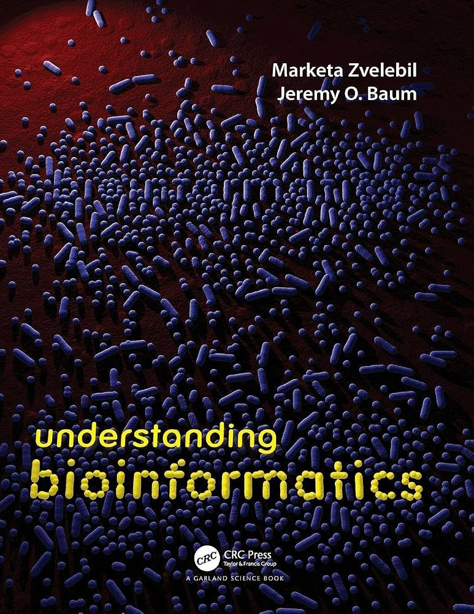
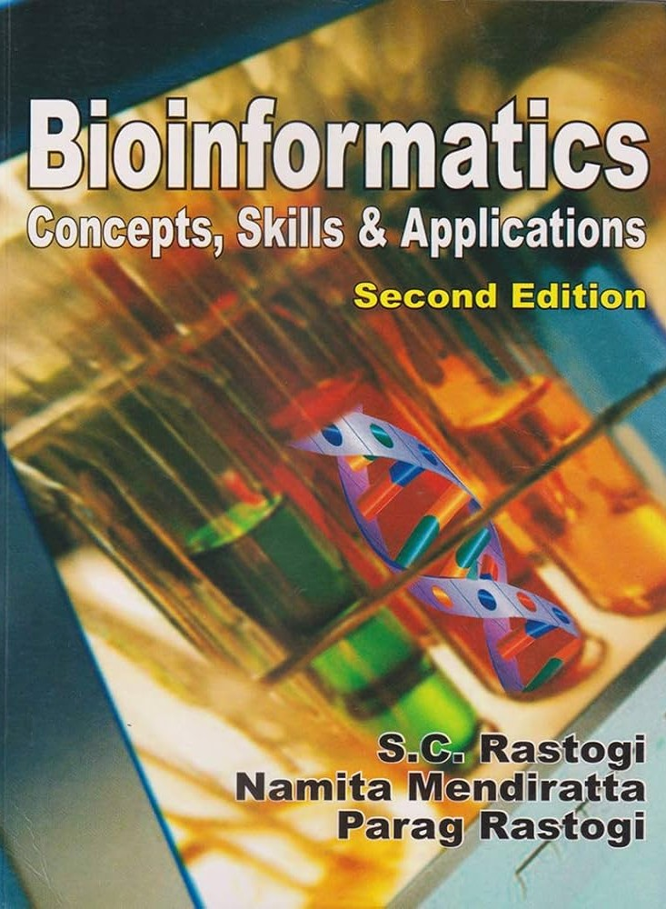

# Useful Resources
A curated collection of resources, notes, codes, and research papers.
------------------------------------------
 

  

------------------------------------------
 

## Bioinformatics 🧬 
[Explore Resources](bioinformatics/README.md)

 

## Statistics 📊 
[Explore Resources](statistics/README.md)

 

## Programming 💻
[Explore Resources](programming/README.md)

 

## Books 📖 

  

 

  

